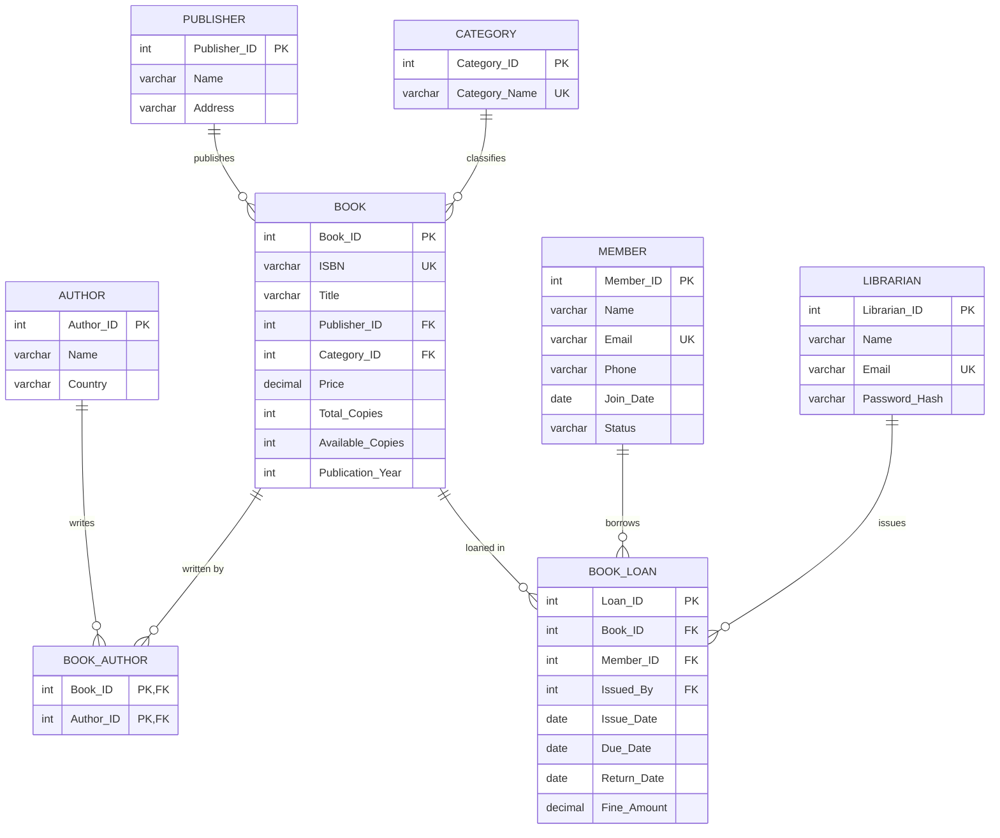

# Full-Stack Library Management System (LibraryDB)
### A Production-Grade Relational Database Management System (RDBMS) College Project


---

## 1. Project Introduction
The **Library Management System** is a complete, full-stack web application engineered specifically for a university **Relational Database Management System (RDBMS) project and viva defense**. Unlike toy projects that rely on SQLite or static mock data, this system strictly interfaces with **MySQL 8.x** via raw parameterized SQL queries, foreign key constraints, CHECK constraints, and ACID transactions with row-level locking.

The user interface follows a modern, responsive design using a navy blue, white, and slate gray palette with Lucide icons and Chart.js analytics.

---

## 2. Project Objectives
1. Provide a comprehensive reference implementation of relational database principles: **1NF, 2NF, 3NF normalization**, entity integrity, referential integrity, and domain constraints.
2. Demonstrate complete coverage of university SQL syllabi: DDL, DML, single-row subqueries, multi-row subqueries (`IN`, `ANY`, `ALL`), correlated subqueries, set membership, `EXISTS`/`NOT EXISTS`, aggregate grouping with `HAVING`, and multi-table joins.
3. Guarantee data consistency during concurrent circulation operations (book issues and returns) using **ACID transactions** and row locking (`SELECT ... FOR UPDATE`).
4. Deliver an intuitive dashboard for librarians to catalog books, manage multiple co-authors, administer memberships, process loans, calculate overdue fines, and generate printable reports.

---

## 3. Technology Stack

### Frontend Layer
- **HTML5 & CSS3**: Custom modern dashboard stylesheet (`static/css/style.css`) with responsive sidebar, cards, tables, badges, and `@media print` rules.
- **JavaScript (ES6+)**: Dynamic modal controls, overdue fine estimation, and toast notifications (`static/js/app.js`).
- **Jinja2**: Server-side template rendering with modular layouts and template inheritance (`templates/base.html`).
- **Lucide Icons**: Clean, lightweight SVG icon system.
- **Chart.js**: Interactive category distribution doughnut charts.

### Backend Layer
- **Python 3.11+**: Core programming language.
- **Flask 3.1.x**: Lightweight WSGI web application framework.
- **mysql-connector-python 8.x+**: Official MySQL driver for raw parameterized query execution and transaction handling.
- **Flask Sessions & Werkzeug**: Session-based authentication with secure password hashing (`scrypt`).
- **python-dotenv**: Environment variable management.

### Database Layer
- **MySQL 8.x (`LibraryDB`)**: 8 core normalized tables with primary keys, composite keys, cascading updates, restricted deletes, and domain CHECK constraints.

---

## 4. System Architecture

```
                    ┌──────────────────────────────────────────────┐
                    │            Librarian Web Browser             │
                    │   (HTML5 / CSS3 / Jinja2 / Chart.js / JS)   │
                    └──────────────────────┬───────────────────────┘
                                           │ HTTP Requests (Session Auth)
                                           ▼
┌───────────────────────────────────────────────────────────────────────────┐
│                             FLASK APPLICATION                             │
│                                                                           │
│   app.py (Factory & Dashboard)             config.py (Env Variables)      │
│                                                                           │
│   ┌─────────────────────────── BLUEPRINTS ────────────────────────────┐   │
│   │ routes/auth.py       routes/books.py        routes/loans.py       │   │
│   │ routes/members.py    routes/authors.py      routes/publishers.py  │   │
│   │ routes/categories.py routes/reports.py                            │   │
│   └──────────────────────────────────┬────────────────────────────────┘   │
│                                      │                                    │
│                     db.py (Connection Pool & Transactions)                │
└──────────────────────────────────────┬────────────────────────────────────┘
                                       │ Raw Parameterized SQL & Transactions
                                       ▼
┌───────────────────────────────────────────────────────────────────────────┐
│                           MySQL 8.x DATABASE                              │
│                               LibraryDB                                   │
│                                                                           │
│   [PUBLISHER] ──1:N──> [BOOK] <──M:N──> [AUTHOR] (via BOOK_AUTHOR)       │
│                           │                                               │
│   [CATEGORY]  ──1:N───────┤                                               │
│                           ▼                                               │
│   [MEMBER]    ──1:N──> [BOOK_LOAN] <──1:N── [LIBRARIAN]                   │
└───────────────────────────────────────────────────────────────────────────┘
```

---

## 5. Entity-Relationship (ER) Model



Detailed documentation of entities, attributes, and relationships is available in [`docs/ER_DIAGRAM.md`](docs/ER_DIAGRAM.md).

---

## 6. Relational Schema & Normalization (3NF)

```
PUBLISHER (Publisher_ID (PK), Name, Address)
CATEGORY (Category_ID (PK), Category_Name (UK))
AUTHOR (Author_ID (PK), Name, Country)
BOOK (Book_ID (PK), ISBN (UK), Title, Publisher_ID (FK), Category_ID (FK), Price, Total_Copies, Available_Copies, Publication_Year)
BOOK_AUTHOR (Book_ID (PK, FK), Author_ID (PK, FK))
MEMBER (Member_ID (PK), Name, Email (UK), Phone, Join_Date, Status)
LIBRARIAN (Librarian_ID (PK), Name, Email (UK), Password_Hash)
BOOK_LOAN (Loan_ID (PK), Book_ID (FK), Member_ID (FK), Issued_By (FK), Issue_Date, Due_Date, Return_Date, Fine_Amount)
```

### Normalization Proof Summary
- **1NF**: All table columns are strictly atomic; multiple authors per book are separated into the bridge relation `BOOK_AUTHOR`.
- **2NF**: All non-prime attributes are fully functionally dependent on the entire primary key. In `BOOK_AUTHOR` (composite key `{Book_ID, Author_ID}`), all attributes are prime, preventing partial dependencies.
- **3NF**: There are no transitive functional dependencies of non-prime attributes on primary keys ($X \rightarrow Y$ implies $X$ is a superkey). For example, Publisher details and Member profiles are decoupled from `BOOK` and `BOOK_LOAN`.

Detailed functional dependency proofs and anomaly elimination matrices are documented in [`docs/RELATIONAL_SCHEMA.md`](docs/RELATIONAL_SCHEMA.md).

---

## 7. Database Setup Instructions

### Option A: Local MySQL Server Installation (Windows)
1. Ensure MySQL 8.x Server is installed and running on port 3306.
2. Open PowerShell or Command Prompt and run:
   ```powershell
   mysql -u root -p < database/schema.sql
   mysql -u root -p < database/sample_data.sql
   ```
3. Alternatively, open **MySQL Workbench 8.0**:
   - Connect to `Local instance MySQL80`.
   - Open and execute `database/schema.sql` (click the Lightning icon).
   - Open and execute `database/sample_data.sql`.

### Option B: Docker Container (One-Line Setup)
If Docker Desktop is installed, start a MySQL 8 container in one command:
```bash
docker run -d --name library_mysql -p 3306:3306 -e MYSQL_ROOT_PASSWORD=root -e MYSQL_DATABASE=LibraryDB mysql:8.0
```
Then import the seed files:
```bash
docker exec -i library_mysql mysql -u root -proot LibraryDB < database/schema.sql
docker exec -i library_mysql mysql -u root -proot LibraryDB < database/sample_data.sql
```

---

## 8. Environment Configuration

Copy `.env.example` to `.env`:
```powershell
Copy-Item .env.example .env
```

Configure your MySQL credentials in `.env`:
```ini
# Flask Secret Key
SECRET_KEY=college-project-secret-key-993812

# Database Connection
DB_HOST=localhost
DB_PORT=3306
DB_USER=root
DB_PASSWORD=your_mysql_password
DB_NAME=LibraryDB

# Business Rules
FINE_PER_DAY=1.00
DEFAULT_LOAN_DAYS=14
```

---

## 9. Installation & Startup Commands

### 1. Install Dependencies
```bash
pip install -r requirements.txt
```

### 2. Run the Application
```bash
python app.py
```
The application will start on:
```
http://127.0.0.1:5000
```

---

## 10. Default Demo Accounts

| Role | Email | Password | Access Level |
| :--- | :--- | :--- | :--- |
| **Head Librarian** | `admin@library.com` | `Admin@123` | Full Administrative Access |
| **Assistant Librarian** | `sarah.jenkins@library.com` | `Admin@123` | Circulation & Cataloging |

*(Passwords are hashed with Werkzeug `scrypt` and cannot be decrypted from the database).*

---

## 11. Explanation of Key SQL Queries

The dedicated script [`database/reports.sql`](database/reports.sql) provides fully commented examples for each required syllabus topic:

### 1. Multi-Table Join (Active Loans)
```sql
SELECT 
    l.Loan_ID, m.Name AS Member_Name, b.Title AS Book_Title,
    lib.Name AS Issued_By, l.Issue_Date, l.Due_Date,
    DATEDIFF(CURRENT_DATE, l.Due_Date) AS Days_Overdue
FROM BOOK_LOAN l
INNER JOIN MEMBER m ON l.Member_ID = m.Member_ID
INNER JOIN BOOK b ON l.Book_ID = b.Book_ID
LEFT JOIN LIBRARIAN lib ON l.Issued_By = lib.Librarian_ID
WHERE l.Return_Date IS NULL;
```

### 2. Correlated Subquery (Books Above Category Average)
```sql
SELECT b1.Book_ID, b1.Title, b1.Price, c.Category_Name
FROM BOOK b1
JOIN CATEGORY c ON b1.Category_ID = c.Category_ID
WHERE b1.Price > (
    SELECT AVG(b2.Price) 
    FROM BOOK b2 
    WHERE b2.Category_ID = b1.Category_ID
);
```

### 3. NOT EXISTS (Books Never Borrowed)
```sql
SELECT b.Book_ID, b.Title, b.ISBN, b.Total_Copies 
FROM BOOK b
WHERE NOT EXISTS (
    SELECT 1 FROM BOOK_LOAN l WHERE l.Book_ID = b.Book_ID
);
```

### 4. Aggregates with HAVING (Category Circulation)
```sql
SELECT 
    c.Category_Name, COUNT(b.Book_ID) AS Book_Count,
    ROUND(AVG(b.Price), 2) AS Avg_Price, SUM(b.Total_Copies) AS Total_Stock
FROM CATEGORY c
JOIN BOOK b ON c.Category_ID = b.Category_ID
GROUP BY c.Category_ID, c.Category_Name
HAVING COUNT(b.Book_ID) >= 2;
```

---

## 12. Issue and Return Transaction Workflow

Circulation operations use **ACID transactions** to eliminate race conditions and stock inconsistencies:

### Issue Book (`routes/loans.py`)
1. Validates member has `Status = 'Active'` (blocks inactive/suspended members).
2. Starts database transaction (`conn.start_transaction()`).
3. Executes atomic decrement:
   ```sql
   UPDATE BOOK 
   SET Available_Copies = Available_Copies - 1 
   WHERE Book_ID = %s AND Available_Copies > 0;
   ```
4. Verifies `rowcount == 1`. If zero, rolls back with error `"Book out of stock"`.
5. Inserts record into `BOOK_LOAN` with `Return_Date = NULL`.
6. Commits transaction (`conn.commit()`).

### Return Book (`routes/loans.py`)
1. Starts database transaction.
2. Row-locks active loan record:
   ```sql
   SELECT Book_ID, Due_Date, Return_Date 
   FROM BOOK_LOAN 
   WHERE Loan_ID = %s 
   FOR UPDATE;
   ```
3. Verifies `Return_Date IS NULL` (prevents double returns).
4. Calculates overdue days: $\max(0, \text{Return\_Date} - \text{Due\_Date})$.
5. Computes fine: $\text{Overdue Days} \times \text{FINE\_PER\_DAY}$.
6. Updates `BOOK_LOAN` with `Return_Date` and `Fine_Amount`.
7. Restores available stock:
   ```sql
   UPDATE BOOK 
   SET Available_Copies = Available_Copies + 1 
   WHERE Book_ID = %s;
   ```
8. Commits transaction.

---

## 13. Running Automated Tests

Run the comprehensive unit and integration test suite:
```bash
python -m pytest tests/ -v
```

Test results:
- `test_login_page_loads`: Verifies login UI rendering.
- `test_unauthenticated_access_redirects`: Enforces access control on all private routes.
- `test_password_hashing`: Validates cryptographic password verification.
- `test_fine_calculation_logic`: Validates overdue penalty mathematics.
- `test_authenticated_session`: Validates session persistence and logout.
- `test_database_offline_handling`: Ensures informative 503 error display when MySQL is unreachable.
- `test_sql_files_exist`: Verifies SQL script accessibility.
- `test_schema_contains_eight_core_tables`: Verifies all 8 core tables.
- `test_schema_integrity_constraints`: Validates all `CHECK`, `UNIQUE`, and `FK` constraints.
- `test_sample_data_covers_all_tables`: Verifies seed data across all entities.
- `test_reports_covers_sql_syllabus`: Verifies complete coverage of required SQL keywords.

---

## 14. Known Limitations
1. **Single Branch / Library**: The schema models a single central library rather than a multi-branch network.
2. **Fine Payment Tracking**: Fines are recorded directly on the loan record upon return. A future enhancement could introduce a dedicated `PAYMENT_RECEIPT` table for partial fine installments.
