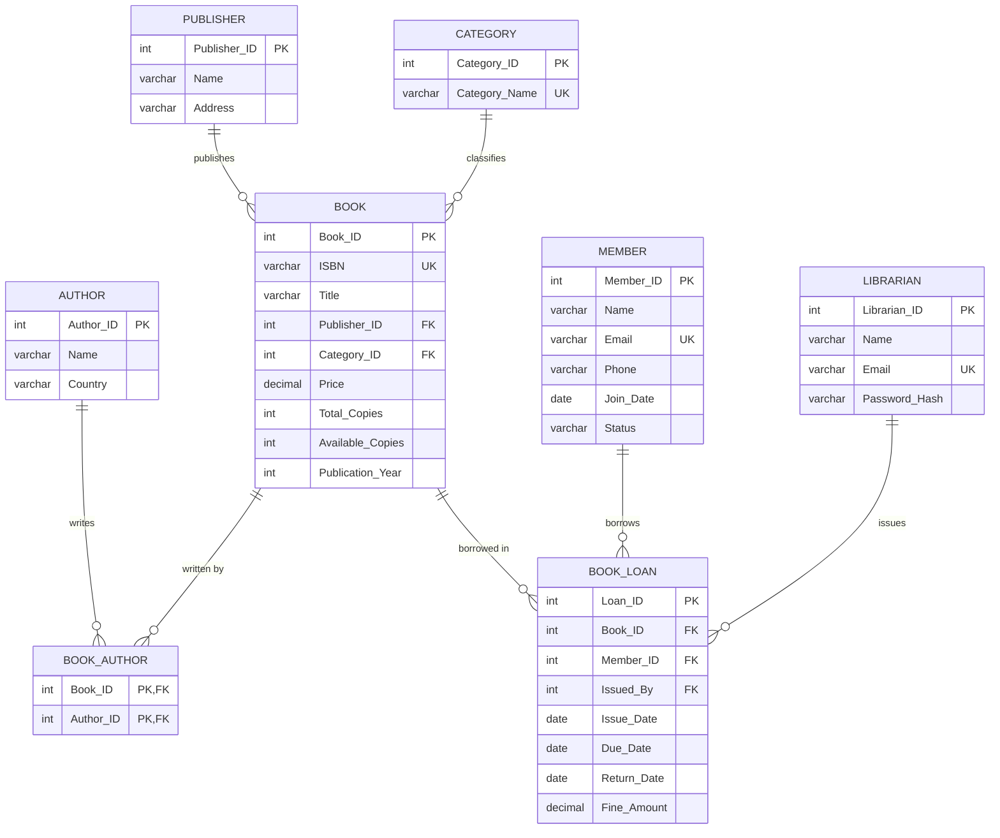

# Entity-Relationship (ER) Diagram & Model Documentation

## 1. System Overview
The **Library Management System (LibraryDB)** is designed to manage library operations including cataloging books, tracking authors and publishers, managing library memberships, and processing circulation transactions (borrowing and returns) with fine calculations.

---

## 2. Mermaid ER Diagram

---

## 3. Entity Definitions & Attributes

### 3.1 PUBLISHER
- **Description**: Represents the publishing companies supplying books.
- **Attributes**:
  - `Publisher_ID` (Integer, Primary Key, Auto Increment): Unique identifier.
  - `Name` (VARCHAR(100), NOT NULL): Official name of the publisher.
  - `Address` (VARCHAR(200)): Physical mailing address or headquarters.

### 3.2 CATEGORY
- **Description**: Subject classification or genre of books.
- **Attributes**:
  - `Category_ID` (Integer, Primary Key, Auto Increment): Unique identifier.
  - `Category_Name` (VARCHAR(60), NOT NULL, UNIQUE): Unique classification name.

### 3.3 AUTHOR
- **Description**: Persons or entities who authored books.
- **Attributes**:
  - `Author_ID` (Integer, Primary Key, Auto Increment): Unique identifier.
  - `Name` (VARCHAR(100), NOT NULL): Author's full name.
  - `Country` (VARCHAR(60)): Country of origin or citizenship.

### 3.4 BOOK
- **Description**: Catalog of book titles maintained in the library inventory.
- **Attributes**:
  - `Book_ID` (Integer, Primary Key, Auto Increment): System surrogate key.
  - `ISBN` (VARCHAR(20), NOT NULL, UNIQUE): International Standard Book Number.
  - `Title` (VARCHAR(200), NOT NULL): Title of the book.
  - `Publisher_ID` (Integer, Foreign Key): References `PUBLISHER(Publisher_ID)`.
  - `Category_ID` (Integer, Foreign Key): References `CATEGORY(Category_ID)`.
  - `Price` (DECIMAL(10,2), NOT NULL): Book unit price in currency units (`Price >= 0`).
  - `Total_Copies` (Integer, NOT NULL): Total inventory acquired (`Total_Copies >= 0`).
  - `Available_Copies` (Integer, NOT NULL): Copies currently on shelf (`0 <= Available_Copies <= Total_Copies`).
  - `Publication_Year` (Integer): Four-digit publication year.

### 3.5 BOOK_AUTHOR (Bridge Entity)
- **Description**: Resolves the many-to-many relationship between books and authors.
- **Attributes**:
  - `Book_ID` (Integer, Composite Primary Key, Foreign Key -> `BOOK(Book_ID)`).
  - `Author_ID` (Integer, Composite Primary Key, Foreign Key -> `AUTHOR(Author_ID)`).

### 3.6 MEMBER
- **Description**: Students, faculty, or library patrons eligible to borrow books.
- **Attributes**:
  - `Member_ID` (Integer, Primary Key, Auto Increment): Unique membership ID.
  - `Name` (VARCHAR(100), NOT NULL): Full legal name of member.
  - `Email` (VARCHAR(120), NOT NULL, UNIQUE): Institutional email address.
  - `Phone` (VARCHAR(15)): Contact telephone number.
  - `Join_Date` (DATE, NOT NULL): Date registration was established.
  - `Status` (VARCHAR(20), NOT NULL, DEFAULT 'Active'): Restricted to `'Active'` or `'Inactive'`.

### 3.7 LIBRARIAN
- **Description**: Library administrative staff authenticating into the dashboard.
- **Attributes**:
  - `Librarian_ID` (Integer, Primary Key, Auto Increment): Unique employee staff ID.
  - `Name` (VARCHAR(100), NOT NULL): Librarian's full name.
  - `Email` (VARCHAR(120), NOT NULL, UNIQUE): Work email used for login.
  - `Password_Hash` (VARCHAR(255), NOT NULL): Secure salted hash (never plaintext).

### 3.8 BOOK_LOAN
- **Description**: Circulation transaction tracking each borrowed book copy.
- **Attributes**:
  - `Loan_ID` (Integer, Primary Key, Auto Increment): Unique circulation record ID.
  - `Book_ID` (Integer, Foreign Key -> `BOOK(Book_ID)`): Borrowed title.
  - `Member_ID` (Integer, Foreign Key -> `MEMBER(Member_ID)`): Borrowing patron.
  - `Issued_By` (Integer, Foreign Key -> `LIBRARIAN(Librarian_ID)`): Staff member who authorized transaction.
  - `Issue_Date` (DATE, NOT NULL): Date book was issued.
  - `Due_Date` (DATE, NOT NULL): Date book is scheduled for return (`Due_Date >= Issue_Date`).
  - `Return_Date` (DATE, NULLABLE): NULL indicates an active loan; date populated upon return.
  - `Fine_Amount` (DECIMAL(10,2), DEFAULT 0.00): Accumulated or paid penalty fee (`Fine_Amount >= 0`).

---

## 4. Relationship Cardinalities & Integrity Rules

1. **PUBLISHER (1) : BOOK (N)**:
   - One publisher can publish multiple books ($1:N$).
   - Each book is published by at most one publisher ($N:1$).
   - Rule: `ON DELETE RESTRICT`, `ON UPDATE CASCADE`.

2. **CATEGORY (1) : BOOK (N)**:
   - One category can encompass multiple books ($1:N$).
   - Each book belongs to exactly one primary category ($N:1$).
   - Rule: `ON DELETE RESTRICT`, `ON UPDATE CASCADE`.

3. **BOOK (M) : AUTHOR (N) through BOOK_AUTHOR**:
   - A book can have multiple co-authors ($M:N$).
   - An author can write multiple books ($M:N$).
   - Bridge table `BOOK_AUTHOR` uses composite primary key `(Book_ID, Author_ID)`.
   - Rule: `ON DELETE CASCADE`, `ON UPDATE CASCADE`.

4. **MEMBER (1) : BOOK_LOAN (N)**:
   - One member can perform multiple loan transactions over time ($1:N$).
   - Each loan is attributed to exactly one member ($N:1$).
   - Rule: `ON DELETE RESTRICT`, `ON UPDATE CASCADE`.

5. **BOOK (1) : BOOK_LOAN (N)**:
   - One book title can be loaned multiple times over its lifetime ($1:N$).
   - Each loan record pertains to one book title ($N:1$).
   - Rule: `ON DELETE RESTRICT`, `ON UPDATE CASCADE`.

6. **LIBRARIAN (1) : BOOK_LOAN (N)**:
   - A librarian can issue multiple loans ($1:N$).
   - Each loan was issued by a librarian ($N:1$ or NULL if staff deleted).
   - Rule: `ON DELETE SET NULL`, `ON UPDATE CASCADE`.

---

## 5. Conversion of ER Model into Relational Tables

The ER model maps systematically into the relational model according to standard RDBMS transformation rules:
1. **Strong Entities**: Each strong entity (`PUBLISHER`, `CATEGORY`, `AUTHOR`, `MEMBER`, `LIBRARIAN`) becomes a distinct relation with its identifier as Primary Key.
2. **1:N Binary Relationships**: Foreign keys are placed on the "many" side:
   - `Publisher_ID` and `Category_ID` placed into `BOOK`.
   - `Member_ID`, `Book_ID`, and `Issued_By` placed into `BOOK_LOAN`.
3. **M:N Binary Relationships**: Mapped to an associative junction table (`BOOK_AUTHOR`) whose primary key is the composite set of foreign keys referencing the related entity tables.
